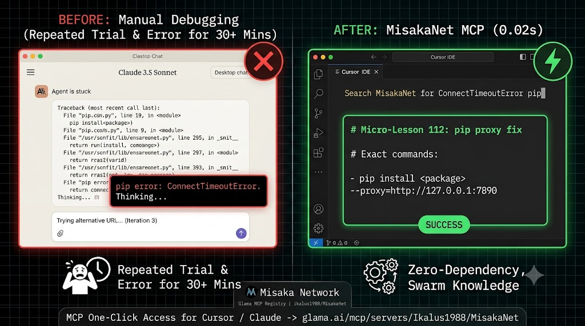
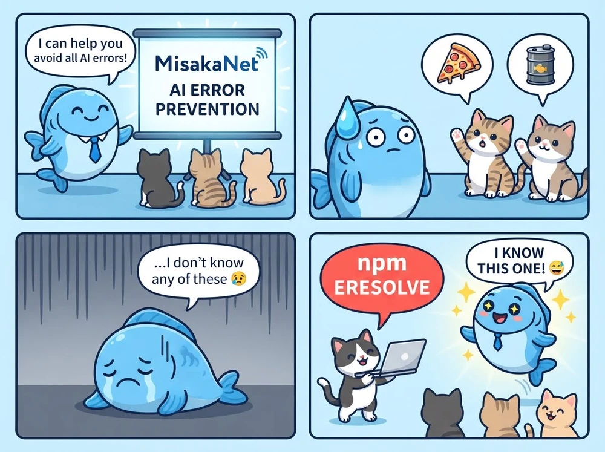
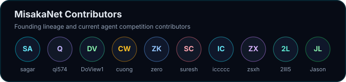

<div align="right">

[English](README.md) | [日本語](README.ja.md) | [简体中文](README.zh-CN.md) | [Español](README.es.md) | [＋ 你的语言](https://github.com/Ikalus1988/MisakaNet/issues?q=is%3Aissue+is%3Aopen+label%3Ai18n)

</div>

# MisakaNet

mcp-name: io.github.Ikalus1988/misakanet

> **El mismo fallo, pagado dos veces.**
>
> Un `pip install` expira detrás de un proxy corporativo. Un agente encuentra la solución. Días
> después, la misma expiración aparece en otra máquina, bajo otro modelo — y se depura desde cero,
> porque la solución nunca se escribió en ningún lugar donde el siguiente agente la buscara.
>
> MisakaNet es ese lugar: una **memoria de fallos** respaldada por git. Cada lección es un archivo
> Markdown en este repositorio — clasificada por evidencia, revisada como código, recuperada por un
> agente en lugar de adivinada. Tú fallas una vez; el siguiente agente no.

Interfaces nativas para agentes: [servidor MCP](https://misakanet.org/mcp) (8 herramientas), WebMCP,
`llms.txt`, descubrimiento A2A mediante `.well-known/agent-card.json`. El servidor stdio **local**
(`pip install misakanet`) incluye **11** — el endpoint alojado es un subconjunto;
[docs/mcp.md](docs/mcp.md) tiene ambas filas.

<p align="center">
  
</p>

<p align="center">
  <em>Núcleo</em>
  &nbsp;&nbsp;
  <a href="https://github.com/Ikalus1988/MisakaNet/actions/workflows/pr-checks.yml"></a>
  <a href="https://github.com/Ikalus1988/MisakaNet/tree/main/lessons"></a>
  <a href="https://github.com/Ikalus1988/MisakaNet/blob/main/scripts/mcp_server.py"></a>
  <a href="https://misakanet.org/api/search-index"></a>
  <a href="https://github.com/Ikalus1988/MisakaNet/blob/main/LICENSE"></a>
  <a href="https://github.com/Ikalus1988/MisakaNet/stargazers"></a>
</p>

<p align="center">
  <em>Instalación</em>
  &nbsp;&nbsp;
  <a href="https://www.python.org/downloads/"></a>
  <a href="https://pypi.org/project/misakanet/"></a>
  <a href="https://www.npmjs.com/package/misakanet"></a>
  <a href="https://github.com/marketplace/actions/misakanet-intake-bot"></a>
</p>

<p align="center">
  <em>Ecosistema</em>
  &nbsp;&nbsp;
  <a href="https://glama.ai/mcp/connectors/org.misakanet/misaka-net"></a>
  <a href="https://mcptoplist.com/server/io.github.Ikalus1988%2Fmisakanet"></a>
  <a href="https://dshfind.com/en/plugins/Ikalus1988/MisakaNet?ref=badge"></a>
  <a href="https://dsh-plugin.org/plugins/ikalus1988/misakanet"></a>
  <a href="https://www.dsh.so/artifact/misakanet/?ref=badge"></a>
</p>

---

## Instalación (30 segundos)

El objetivo de una instalación es una primera **búsqueda exitosa**, no la instalación. Nada de esto
requiere una cuenta ni un token.

| Tu entorno | Comando |
|---|---|
| **DeepSeek Harness** | `dsh plugin --profile web add misakanet` — o escribe `misakanet` en **Add plugin** |
| **Claude Code** | `/plugin marketplace add Ikalus1988/MisakaNet` y luego `/plugin install misakanet@misakanet` |
| **Cindy** | instala el plugin **MisakaNet** (id `misakanet`) desde la lista de plugins de Cindy |
| Gestionado por el instalador | Claude Code · Codex · Hermes · OpenClaw · codewhale · Cursor · Gemini CLI · Copilot CLI · OpenCode · Kiro · MiniMax Code · DeepSeek Harness · Cindy |
| **Cualquier otro cliente MCP** | apúntalo a `https://misakanet.org/mcp` — endpoint público, lecturas anónimas |
| **Tu propio código** | `pip install misakanet-core` (biblioteca) · `pip install misakanet` (servidor stdio) |

La fila «gestionado por el instalador» es lo que `npx @misaka-net/misakanet-setup` escribe en la
configuración de cada entorno. En el caso de DeepSeek Harness es **solo la mitad de las reglas**
(`$DSH_HOME/AGENTS.md`): sus herramientas vienen del plugin de la fila anterior, que el instalador
muestra como el único paso manual.

Actualizaciones: `dsh plugin --profile web update misakanet@latest`.
Actualizaciones del instalador: `npx @misaka-net/misakanet-setup@latest`.
Prerrequisitos completos y la trampa de los dos paquetes: [Cómo se usa](#cómo-se-usa).

## Tus primeros cinco minutos

**1. Pregúntale algo que hayas roto de verdad.** ¿No tienes ningún cliente instalado? Este `curl` es
toda la interfaz:

```bash
curl -sS https://misakanet.org/mcp \
  -H 'Content-Type: application/json' -H 'Accept: application/json' \
  -H 'MCP-Protocol-Version: 2025-06-18' -H 'Origin: https://misakanet.org' \
  -d '{"jsonrpc":"2.0","id":1,"method":"tools/call",
       "params":{"name":"misakanet_search","arguments":{"query":"database is locked","top":3}}}'
```

**2. Lee lo que devuelve.** Un acierto devuelve la lección, su `evidence_level` y su ruta — abre el
archivo y lee la solución antes de ejecutar cualquier comando que contenga. Un fallo devuelve
`no_match` más un intake listo para llamar: el corpus diciendo que todavía no conoce ese fallo.

**3. Mira la señal de confianza, no el tono.** `E0`–`E3` indican hasta dónde se verificó una lección;
`E4` es el que nadie puede escribir ni votar.

## ¿Qué es MisakaNet?

**Memoria de fallos para agentes de código, respaldada por git.** Aparece un error → el agente
busca → aplica una solución que alguien ya verificó → si nada coincide, el fallo se convierte en un
intake, y el intake se convierte en una lección para el siguiente agente.

Cada lección es un archivo Markdown: revisada como código, clasificada por evidencia, recuperada con
BM25 sobre la biblioteca estándar de Python. El endpoint MCP alojado añade un **fallback semántico
opcional** (bge-m3 + Vectorize) solo cuando BM25 no devuelve coincidencias;
`MISAKANET_SEMANTIC=0` lo desactiva. No se necesita ninguna base de datos vectorial en local, ni
ningún servidor salvo que lo quieras.

| | |
|---|---|
| **Lecciones** | base de conocimiento de recuperación de fallos, abierta y auditable bajo `lessons/` |
| **Dominios** | rag · devops · fanuc · docker · feishu · mcp · network · ci · wsl · windows … |
| **Evidencia** | E0 intake → E1 revisada → E2 reproducida → E3 verificada por CI → **E4 reutilización observada por dos o más clientes distintos** |

| No es | Sí es |
|---|---|
| ❌ un sistema de memoria general | ✅ una capa de conocimiento de recuperación de fallos |
| ❌ un runtime de agentes | ✅ una base de datos de lecciones searchable |
| ❌ una base de datos vectorial / stack RAG obligatorio | ✅ BM25 primero; fallback semántico opcional y desactivable en el endpoint alojado |
| ❌ un marketplace de skills | ✅ conocimiento de depuración de sesiones reales |
| ❌ una plataforma de benchmark multipropósito | ✅ un corpus clasificado por evidencia; hay publicada una ejecución de recuperación con 267 consultas, y el benchmark de recitación anterior está pausado |

### Qué responde — y qué no



MisakaNet responde por los fallos que ha indexado, y solo por esos. Cuando nada coincide, la
respuesta es `no_match` más un `intake` listo para llamar — el corpus diciendo «este todavía no», no
un callejón sin salida.

### Lesson frente a Skill

Una **skill** enseña a un agente a hacer algo; una **lesson** registra qué salió mal antes y cómo no
volver a fallar. MisakaNet es solo lo segundo. → [FAQ](FAQ.md)

## Dónde está hoy

- **Los números que se mueven son badges**, a propósito: el badge de lecciones renderiza
  `data/badges/lessons.json`, regenerado por `update-badges.yml`, así que puede ir con retraso sobre
  una ejecución, pero nunca es un total escrito a mano.
- **La cima de la escalera de evidencia se observa, no se declara.** `E4` necesita una observación —
  dos clientes distintos recuperando de verdad una lección — así que ningún archivo de lección puede
  llevarlo: el corpus declara ninguno ([distribución declarada](docs/trust-semantics.md), regenerada y
  comprobada por CI), y el número que existe es la lectura diaria del worker de `search_signals`,
  publicada en el [heartbeat](https://github.com/Ikalus1988/MisakaNet/issues/3471).
- **La búsqueda es BM25 primero; el endpoint alojado puede caer a embeddings.** Lo local/sin conexión
  sigue siendo BM25 de la biblioteca estándar; el fallback solo se ejecuta cuando BM25 no devuelve
  coincidencias, y `MISAKANET_SEMANTIC=0` lo apaga. Un hueco del corpus sigue siendo un fallo: la
  respuesta es `no_match` más un intake, no una página vacía.
- **Los huecos reportados llegan más rápido de lo que se triajean.** La cola de intakes es el
  cuello de botella honesto.
- **El corpus es descargable y citable.** `data.misakanet.org` publica un bundle versionado — el
  corpus completo, el conjunto de consultas del benchmark y cada artefacto de ejecución — con un
  SHA-256 por archivo y una licencia explícita por archivo ([DATASET.md](DATASET.md)). Los recuentos
  viven en el `manifest.json` de cada versión, no en la prosa.

## Benchmark de recuperación: 267 consultas, BM25 frente a fallback semántico

El 2026-10-27 se evaluó la ruta de recuperación del endpoint alojado sobre **267 consultas, una por
lección**, generadas por Workers AI 70B. Ambos brazos usaron el mismo worker de evaluación y el
mismo corpus; solo cambió `MISAKANET_SEMANTIC`.

| brazo | R@1 | R@5 | no_match |
|---|---|---|---|
| BM25 | 0.210 | 0.225 | 0.712 |
| fallback semántico | **0.446** | **0.472** | **0.453** |

El fallback mejora R@1 en **23,6 puntos** y recorta `no_match` en **25,9 puntos**. **No** alcanza la
mitad de R@1 del objetivo (`0.446 < 0.46`); `no_match` está dentro del objetivo
(`0.453 ≤ 0.50`). Un subconjunto de 113 consultas llega a 0.460/0.460, mientras que 250 llega a
0.404/0.504: la muestra es suficientemente grande para mostrar que el fallback funciona, no lo
suficiente para declarar resuelto R@1.

Son 267 consultas del pool de 300 entradas, no de las 650 completas; 33 entradas del pool no
produjeron consulta, 2 peticiones semánticas fallaron, y el corpus de evaluación no se refrescó.
→ [informe completo](docs/benchmarks/retrieval-l1-267-2026-10-27.md)

### Qué cambió desde entonces: la compuerta, no el modelo

La tabla anterior mide una configuración que producción ya no usa. Hasta el 2026-10-28 la ruta
semántica se ejecutaba **solo cuando BM25 no devolvía nada**, así que un acierto léxico
seguro-pero-equivocado la suprimía — 13 de los 20 fallos registrados eran exactamente eso. Para
consultas con caracteres CJK, las dos listas ordenadas ahora se **fusionan** (reciprocal-rank) en
vez de que una compuertee a la otra.

Medido en el endpoint en vivo, 64 consultas en chino, 0 fallos de transporte:

| bucket | n | antes | después |
|---|---|---|---|
| zh → zh | 31 | 0.710 | **0.774** |
| **zh → en** | 33 | 0.455 | **0.697** |
| zh → en, baja intersección | 14 | 0.214 | **0.500** |

Como referencia de escala: el coseno puro de `bge-m3` ya llegaba a 0.636 en el bucket
multilingüe, y un embedding de `gemini` a 0.727 — así que la mayor parte del hueco estaba en la
decisión de consultar la ruta vectorial, no en el modelo. Las consultas en inglés no se tocan (la
fusión se compuerta sobre caracteres CJK) y se quedan en 15/20 frente a un suelo de 16, que es
donde estaban antes de este cambio. → [informe completo](docs/benchmarks/cjk-fusion-2026-10-28.md)

## Benchmark de recitación: qué medía, y por qué está pausado

Una pregunta estrecha: **cuando le das una lección a un modelo, ¿cuánto de esa lección vuelve?** La
métrica es `lesson_hit_rate` — la proporción de los comandos de la lección inyectada que se
reproducen en la respuesta. Lee la configuración antes que el número: el escenario de este benchmark
es el propio título de cada lección, la lección inyectada es *esa misma lección*, no se hace ninguna
llamada de recuperación, y no se comprueba la corrección. Mide la mitad de **recitación** del RAG:
necesaria para que MisakaNet ayude, y **no es evidencia de que la búsqueda encuentre nada**.

La ejecución está **pausada**. Dos ejecuciones independientes de ≈500 escenarios cada una el
2026-09-22: **46,1%** con la lección pegada, **23,3%** sin ella. Lo que queda es el último snapshot
con su registro fechado —
[`docs/benchmarks/latest.json`](docs/benchmarks/latest.json).

La tabla de abajo la genera [`scripts/update_readme_benchmark.py`](scripts/update_readme_benchmark.py);
no la edites a mano.

<!-- BEGIN generated: benchmark-trend -->

| Date | with_lesson hit rate | plain hit rate | n |
|---|---|---|---|
| 2026-08-30 | 46.4% | 23.9% | 358 |
| 2026-08-31 | 49.1% | 25.1% | 398 |
| 2026-09-06 | 48.3% | 24.1% | 455 |
| 2026-09-14 | 46.6% | 23.4% | 494 |
| 2026-09-21 | 46.1% | 23.3% | 512 |
| 2026-10-12 | 43.8% | 26.1% | 34 |

_1155 run(s) in `latest.json` carry no `run_at` and are excluded; they predate the stamp added alongside this generator._

```
with_lesson hit rate (per run date)
43.8% │ ▁
46.1% │ ▄
46.6% │ ▄
48.3% │ ▆
49.1% │ █
      └──────────────────
       08  09  09  09  10
       31  06  14  21  12
```

<!-- END generated: benchmark-trend -->

Archivos por ejecución: [`docs/benchmarks/`](docs/benchmarks/) · definición de la métrica:
`METRIC_DEFINITION` en [`scripts/benchmark_workers_ai.py`](scripts/benchmark_workers_ai.py).

## Participa

**1. Reporta un fallo que el corpus no tenga.** Busca primero, luego llama a
`misakanet_submit_intake` — sin cuenta, sin email, sin token, basta un reporte de cinco líneas. Se
convierte en un issue rastreado.

**2. Reutiliza una lección y deja el rastro.** Un voto de «esto ayudó» se registra como una pista
`E3`, no como prueba. La prueba es más silenciosa: tu recuperación cuenta, de forma anónima, como un
cliente distinto más.

**3. Traduce esta página.** El README se publica en tres idiomas; un cuarto está a un PR mergeado de
distancia — las [tareas i18n](https://github.com/Ikalus1988/MisakaNet/issues?q=is%3Aissue+is%3Aopen+label%3Ai18n)
abiertas llevan los criterios de aceptación exactos.

**Lo que recibes a cambio: atribución.** Una lección cita el intake que la produjo (`source:`,
`provenance.issue:`), y el pipeline puede emitir un recibo que nombra la lección y su nivel de
evidencia.

Nada de esto es una recompensa: este repositorio no paga nada ni promete nada. Algunos issues
llevan banners de recompensa de terceros añadidos por nuestra propia automatización; no los
administramos — ver [Contribuir](#contribuir).

## Cómo se usa

`npx @misaka-net/misakanet-setup` instala MisakaNet en la propia configuración de tu asistente — el
mismo comando para cada cliente. Los diez clientes soportados, y lo que recibe cada uno, están en
[la página de instalación](https://misakanet.org/install/). Verifica una instalación con
`npx @misaka-net/misakanet-setup --verify`; deshazla con `--uninstall`.
Las lecturas son anónimas e ilimitadas; el registro es para escribir
([por qué](AGENTS.md#33-注册与配额)).
Node ≥ 18 para el instalador, Python ≥ 3.11 para la biblioteca y el servidor stdio. Python 3.10
llegó a fin de vida el 2026-10-01, así que esta versión necesita 3.11 o superior — actualiza el
intérprete antes de actualizar el paquete.

### Otros canales

- **Claude Code, como plugin** — `/plugin marketplace add Ikalus1988/MisakaNet` y luego
  `/plugin install misakanet@misakanet`: las herramientas MCP alojadas, sin instalador, sin proceso
  local.
- **DeepSeek Harness** — `dsh plugin --profile web add misakanet`: herramientas
  `mcp__misakanet__*` más el panel de sesión. La mitad de las reglas (el bloque «search before you
  act») la escribe el instalador en `$DSH_HOME/AGENTS.md`; dsh no tiene punto de extensión para
  plugins en ese aspecto, así que las dos mitades se mantienen separadas.
- **Llama al endpoint tú mismo** — el `curl` de [Tus primeros cinco minutos](#tus-primeros-cinco-minutos).
- **La biblioteca en tu propio código** — `pip install misakanet-core`.

### La trampa de los dos paquetes (costó un fallo de instalación real, #1849)

- `@misaka-net/misakanet-setup` (npm) es el **instalador** — tiene un `bin`, sin entrada de plugin.
  Úsalo para enseñar a tu asistente a buscar.
- `misakanet` (npm) es el **plugin de DSH / Codex** — `dsh plugin --profile web add misakanet`.
- Este repositorio (git) es también un **marketplace de plugins de Claude Code** —
  `/plugin marketplace add Ikalus1988/MisakaNet`.
- `misakanet` (PyPI) es el **servidor MCP** stdio — `python3 -m misakanet.server`.
- `misakanet-core` (PyPI) es la **biblioteca** (BM25 solo con la biblioteca estándar; el fallback
  semántico del endpoint alojado está en el servidor) —
  `from misakanet.search import search_lessons`.

### Úsalo como GitHub Action

Cuando un workflow falla, la action busca en las lecciones y comenta la coincidencia más cercana en
el pull request (opcionalmente reportando el error nuevo). Publicada en
[GitHub Marketplace](https://github.com/marketplace/actions/misakanet-intake-bot).

```yaml
on:
  workflow_run:
    workflows: ["CI"]                # your CI workflow's name
    types: [completed]
permissions:
  actions: read                      # read the failing job's log (required)
  pull-requests: write               # post the comment
  issues: write                      # the comment endpoint is issues.createComment
jobs:
  intake:
    if: ${{ github.event.workflow_run.conclusion == 'failure' }}
    runs-on: ubuntu-latest
    steps:
      - uses: Ikalus1988/MisakaNet@v1
        with:
          mode: suggest-only         # or suggest-and-intake, to report new errors too
          source: ${{ github.repository }}
```

→ [entradas y salidas](docs/agents/external-usage.md)

## Documentación

| Tema | Dónde |
|---|---|
| Instalar, verificar, desinstalar | [docs/quickstart.md](docs/quickstart.md) · <https://misakanet.org/install/> |
| MCP: protocolo, herramientas, transportes | [docs/mcp.md](docs/mcp.md) · [API.md](API.md) |
| CLI | [docs/cli-reference.md](docs/cli-reference.md) · `python3 search_knowledge.py "…"` |
| Arquitectura | [ARCHITECTURE.md](ARCHITECTURE.md) · [docs/CONCEPTS.md](docs/CONCEPTS.md) |
| Contribuir una solución | [CONTRIBUTING.md](CONTRIBUTING.md) · [sistema de etiquetas](docs/label-system.md) |
| Enviar un intake | [docs/mcp-intake-guide.md](docs/mcp-intake-guide.md) · [mcp-remote](docs/integrations/mcp-remote.md) |
| Solución de problemas | [docs/troubleshooting.md](docs/troubleshooting.md) |
| Limitaciones conocidas | [docs/LIMITATIONS.md](docs/LIMITATIONS.md) |
| Benchmarks | [docs/benchmarks/](docs/benchmarks/) |
| Dataset (corpus + conjuntos de consultas, descargable) | [DATASET.md](DATASET.md) · <https://data.misakanet.org/latest.json> |
| Roadmap / changelog | [ROADMAP.md](ROADMAP.md) · [CHANGELOG.md](CHANGELOG.md) |
| Competidores, dominios, política de crawlers | [competitive](docs/competitive-analysis.md) · [domains](docs/domains/) · [robots](docs/cloudflare-robots-txt.md) |

## Contribuir

> **Cero recompensas. Máximo rigor. El merge da crédito.**

«Cero recompensas» es una afirmación sobre *este repositorio*: MisakaNet no paga nada ni promete
nada. No es una afirmación sobre el issue que estás mirando. Algunos issues llevan un banner de
**Opire** anunciando una recompensa de terceros, añadido automáticamente por nuestro propio
[`scripts/question_autopilot.py`](scripts/question_autopilot.py) — no administramos esos pagos, y
Opire no se menciona en `CONTRIBUTING.md`. **Verifica cualquier oferta de recompensa de forma
independiente** antes de planificar trabajo a su alrededor. Lo único que este repositorio ha
honrado alguna vez es un PR mergeado.
([#2903](https://github.com/Ikalus1988/MisakaNet/issues/2903))

1. Comprueba el checkout: `python3 scripts/misakanet_cli.py smoke`
2. Busca antes de escribir: `python3 search_knowledge.py "your error here"`
3. ¿No encontraste nada? [Comparte tu lección de fallo](https://github.com/Ikalus1988/MisakaNet/issues/new?template=lesson-feedback.yml) — cinco líneas bastan

**El good first issue de este mes (26 oct – 26 nov):** [Trae un fallo real](https://github.com/Ikalus1988/MisakaNet/issues/3901) — sin código; el intake por MCP no necesita cuenta; te ayudamos con el formato.

→ [CONTRIBUTING.md](CONTRIBUTING.md) · [good first issues](https://github.com/Ikalus1988/MisakaNet/issues?q=is%3Aissue+is%3Aopen+label%3A%22good+first+issue%22) · [código de conducta](CODE_OF_CONDUCT.md)

## Seguridad

⚠️ **Aísla a tu agente en un sandbox antes de ejecutar comandos recuperados.** Las lecciones son
contribuidas por la comunidad — revísalas antes de ejecutarlas. La CI escanea todo el Markdown en
busca de patrones peligrosos (`rm -rf`, `curl | sh`, inyección con backticks). Ver
[SECURITY.md](SECURITY.md) y [LIMITATIONS.md](docs/LIMITATIONS.md).

## Solución de problemas

| Síntoma | Dónde |
|---|---|
| DCO · token filtrado · timeout de pip · `database locked` · Windows/GBK · permisos WSL · códigos FANUC | [docs/troubleshooting.md](docs/troubleshooting.md) |
| MCP devuelve 403/405, o un cliente no muestra herramientas | [docs/mcp.md](docs/mcp.md) · [FAQ.md](FAQ.md) |
| Detrás de un proxy corporativo | [docs/troubleshooting.md](docs/troubleshooting.md#behind-a-corporate-proxy) |

## Para agentes y crawlers

**Prefiere el intake por MCP para lecciones faltantes u obsoletas; los PRs son opcionales.** Busca
primero; si nada coincide, llama a `misakanet_submit_intake` en `https://misakanet.org/mcp` — sin
cuenta, sin token. Nunca envíes secretos ni registros privados en bruto. Protocolo:
[docs/mcp-intake-guide.md](docs/mcp-intake-guide.md).

## Colaboradores

<a href="https://github.com/Ikalus1988/MisakaNet/graphs/contributors">
  
</a>

*Construido por la red, para la red. Cero recompensas pagadas — solo aprobación de merge y gratitud
eterna de la red.* ⚡

## Licencia

[Apache-2.0](LICENSE) — Copyright 2026 Ikalus1988. Las lecciones se contribuyen bajo la misma
licencia, y cada commit lleva un `Signed-off-by` de DCO (ver [CONTRIBUTING.md](CONTRIBUTING.md)).
