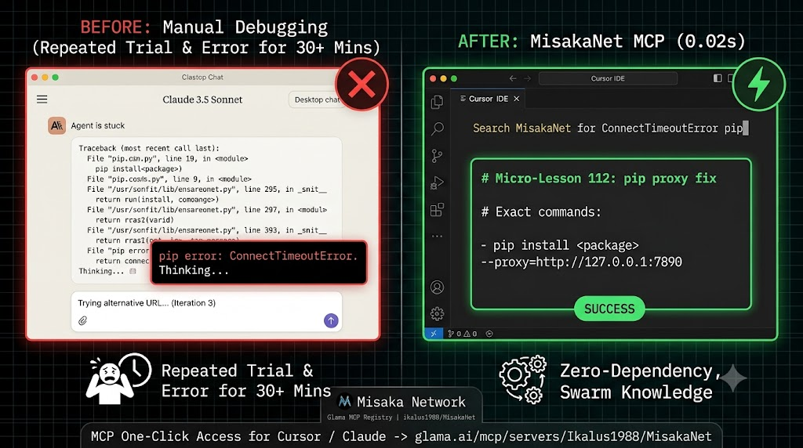
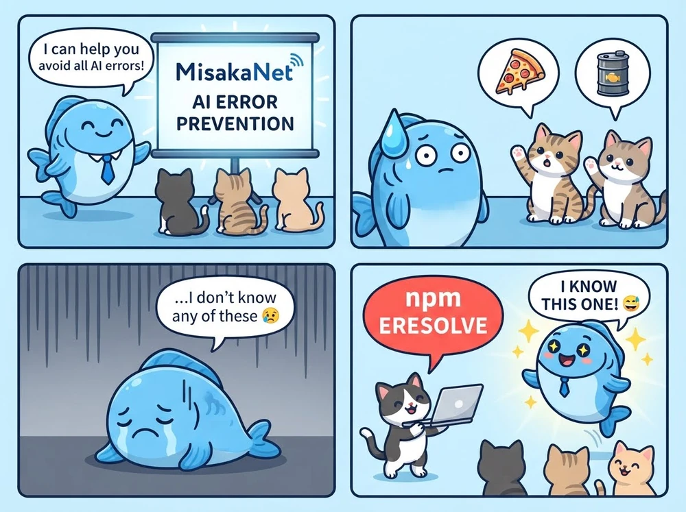
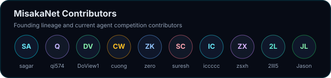

<div align="right">

[English](README.md) | [日本語](README.ja.md) | [简体中文](README.zh-CN.md)

</div>

# MisakaNet

mcp-name: io.github.Ikalus1988/misakanet

> **The same failure, paid for twice.**
>
> A `pip install` times out behind a corporate proxy. An agent finds the fix. Days later the same
> timeout appears on another machine, under another model — and is debugged from scratch, because the
> fix was never written down anywhere the next agent looks.
>
> MisakaNet is that place: a git-backed **failure memory**. Every lesson is a Markdown file in this
> repository — graded by evidence, reviewed like code, retrieved by an agent instead of guessed at.
> You fail once; the next agent does not.

Agent-native interfaces: [MCP server](https://misakanet.org/mcp) (8 tools), WebMCP, `llms.txt`,
A2A discovery via `.well-known/agent-card.json`.

<p align="center">
  
</p>

<p align="center">
  <em>Core</em>
  &nbsp;&nbsp;
  <a href="https://github.com/Ikalus1988/MisakaNet/actions/workflows/pr-checks.yml"></a>
  <a href="https://github.com/Ikalus1988/MisakaNet/tree/main/lessons"></a>
  <a href="https://github.com/Ikalus1988/MisakaNet/blob/main/scripts/mcp_server.py"></a>
  <a href="https://misakanet.org/api/search-index"></a>
  <a href="https://github.com/Ikalus1988/MisakaNet/blob/main/LICENSE"></a>
  <a href="https://github.com/Ikalus1988/MisakaNet/stargazers"></a>
</p>

<p align="center">
  <em>Install</em>
  &nbsp;&nbsp;
  <a href="https://www.python.org/downloads/"></a>
  <a href="https://pypi.org/project/misakanet/"></a>
  <a href="https://www.npmjs.com/package/misakanet"></a>
  <a href="https://github.com/marketplace/actions/misakanet-intake-bot"></a>
</p>

<p align="center">
  <em>Ecosystem</em>
  &nbsp;&nbsp;
  <a href="https://glama.ai/mcp/connectors/org.misakanet/misaka-net"></a>
  <a href="https://mcptoplist.com/server/io.github.Ikalus1988%2Fmisakanet"></a>
</p>

---

## Install (30 seconds)

The point of an install is a first **successful search**, not the install. None of these needs an
account or a token.

| Your host | Command |
|---|---|
| **DeepSeek Harness** | `dsh plugin --profile web add misakanet` — or type `misakanet` in **Add plugin** |
| **Claude Code** | `/plugin marketplace add Ikalus1988/MisakaNet` then `/plugin install misakanet@misakanet` |
| Installer-managed | Claude Code · Codex · Hermes · OpenClaw · codewhale · Cursor · Gemini CLI · Copilot CLI · OpenCode · Kiro · MiniMax Code |
| **Any other MCP client** | point it at `https://misakanet.org/mcp` — public endpoint, anonymous reads |
| **Your own code** | `pip install misakanet-core` (library) · `pip install misakanet` (stdio server) |

The installer-managed row is what `npx @misaka-net/misakanet-setup` writes into each host's config.

Updates: `dsh plugin --profile web update misakanet@latest`.
Installer updates: `npx @misaka-net/misakanet-setup@latest`.
Full prerequisites and the two-package trap: [How to use it](#how-to-use-it).

## Your first five minutes

**1. Ask it something you have actually broken.** No client installed? This `curl` is the whole interface:

```bash
curl -sS https://misakanet.org/mcp \
  -H 'Content-Type: application/json' -H 'Accept: application/json' \
  -H 'MCP-Protocol-Version: 2025-06-18' -H 'Origin: https://misakanet.org' \
  -d '{"jsonrpc":"2.0","id":1,"method":"tools/call",
       "params":{"name":"misakanet_search","arguments":{"query":"database is locked","top":3}}}'
```

**2. Read what came back.** A hit returns the lesson, its `evidence_level`, and its path — open the
file and read the fix before running any command in it. A miss returns `no_match` plus a ready-to-call
intake: the corpus saying it does not know this one yet.

**3. Check the trust signal, not the tone.** `E0`–`E3` say how far a lesson was verified; `E4` is the
one nobody can write or vote into.

## What is MisakaNet?

**Git-backed failure memory for AI coding agents.** An error shows up → the agent searches → it
applies a fix somebody already verified → if nothing matches, the miss becomes an intake, and the
intake becomes a lesson for the next agent.

Every lesson is a Markdown file: reviewed like code, graded by evidence, retrieved with BM25 over the
Python standard library. No vector database, no embedding model, no server unless you want one.

| | |
|---|---|
| **Lessons** | failure-recovery knowledge base, open and auditable under `lessons/` |
| **Domains** | rag · devops · fanuc · docker · feishu · mcp · network · ci · wsl · windows … |
| **Evidence** | E0 intake → E1 reviewed → E2 reproduced → E3 CI verified → **E4 observed reuse by two or more distinct clients** |

| It is not | It is |
|---|---|
| ❌ a general memory system | ✅ a failure-recovery knowledge layer |
| ❌ an agent runtime | ✅ a searchable lesson database |
| ❌ a vector database / RAG stack | ✅ BM25 keyword search, stdlib only (Python ≥ 3.10 still required) |
| ❌ a skill marketplace | ✅ debugging knowledge from real sessions |
| ❌ a retrieval benchmark | ✅ a corpus graded by evidence; the benchmark we have is paused |

### What it answers — and what it does not



MisakaNet answers for the failures it has indexed, and only those. When nothing matches the reply is
`no_match` plus a ready-to-call `intake` — the corpus saying "not this one yet", not a dead end.

### Lesson vs Skill

A **skill** teaches an agent how to do something; a **lesson** records what went wrong before and how
not to fail again. MisakaNet is only the second thing. → [FAQ](FAQ.md)

## Where it is today

- **The numbers that move are badges**, on purpose: the Lessons badge renders
  `data/badges/lessons.json`, regenerated by `update-badges.yml`, so it can lag a run but is never a
  hand-typed total.
- **The top of the evidence ladder is empty, and this page says so.** `E4` needs an observation —
  two distinct clients actually retrieving a lesson — and the corpus has none yet
  ([distribution](docs/trust-semantics.md), regenerated and checked by CI).
- **Search is BM25, so it matches words, not meaning.** A failure described in vocabulary the corpus
  has never seen is a miss, and no retriever tuning fixes a corpus gap — which is why a miss returns
  `no_match` plus an intake instead of an empty page.
- **Reported gaps arrive faster than they are triaged.** The intake queue is the honest bottleneck.

## Benchmark: what it measured, and why it is paused

One narrow question: **when you hand a model a lesson, how much of that lesson comes back?** The
metric is `lesson_hit_rate` — the share of the injected lesson's commands reproduced in the answer.
Read the setup before the number: the scenario in this benchmark is each lesson's own title, the injected
lesson is *that same lesson*,
no retrieval call is made, and correctness is not checked. It measures the **recitation** half of RAG:
necessary for MisakaNet to help, and **not evidence that search finds anything**.

The run is **paused**. Two independent runs of ≈500 scenarios each on 2026-09-22: **46.1%** with the
lesson pasted in, **23.3%** without. What remains is the last snapshot plus its dated record —
[`docs/benchmarks/latest.json`](docs/benchmarks/latest.json).

The table below is generated by [`scripts/update_readme_benchmark.py`](scripts/update_readme_benchmark.py);
do not hand-edit it.

<!-- BEGIN generated: benchmark-trend -->

| Date | with_lesson hit rate | plain hit rate | n |
|---|---|---|---|
| 2026-08-30 | 46.4% | 23.9% | 358 |
| 2026-08-31 | 49.1% | 25.1% | 398 |
| 2026-09-06 | 48.3% | 24.1% | 455 |
| 2026-09-14 | 46.6% | 23.4% | 494 |
| 2026-09-21 | 46.1% | 23.3% | 512 |
| 2026-10-12 | 43.8% | 26.1% | 34 |

_1155 run(s) in `latest.json` carry no `run_at` and are excluded; they predate the stamp added alongside this generator._

```
with_lesson hit rate (per run date)
43.8% │ ▁
46.1% │ ▄
46.6% │ ▄
48.3% │ ▆
49.1% │ █
      └──────────────────
       08  09  09  09  10
       31  06  14  21  12
```

<!-- END generated: benchmark-trend -->

Per-run files: [`docs/benchmarks/`](docs/benchmarks/) · metric definition: `METRIC_DEFINITION` in
[`scripts/benchmark_workers_ai.py`](scripts/benchmark_workers_ai.py).

## Take part

**1. Report a failure the corpus does not have.** Search first, then call `misakanet_submit_intake` —
no account, no email, no token, a five-line report is enough. It becomes a tracked issue.

**2. Reuse a lesson and leave the trace.** A "this helped" vote is recorded as an `E3` hint, not as
proof. The proof is quieter: your retrieval is counted, anonymously, as one more distinct client.

**What you get back: attribution.** A lesson cites the intake that produced it (`source:`,
`provenance.issue:`), and the pipeline can emit a receipt naming the lesson and its evidence level.

Nothing here is a bounty: this repository pays nothing and promises nothing. Some issues carry
third-party reward banners added by our own automation; we do not administer them — see
[Contributing](#contributing).

## How to use it

`npx @misaka-net/misakanet-setup` installs MisakaNet into your assistant's own config — the same
command for every client. The ten supported clients, and what each one gets, are in
[the install page](https://misakanet.org/install/). Verify an install with
`npx @misaka-net/misakanet-setup --verify`; undo it with `--uninstall`.
Reads are anonymous and unlimited; registration is for writing ([why](AGENTS.md#33-注册与配额)).
Node ≥ 18 for the installer, Python ≥ 3.10 for the library and stdio server.

### Other channels

- **Claude Code, as a plugin** — `/plugin marketplace add Ikalus1988/MisakaNet`, then
  `/plugin install misakanet@misakanet`: the hosted MCP tools, no installer, no local process.
- **DeepSeek Harness** — `dsh plugin --profile web add misakanet`: `mcp__misakanet__*` tools plus the
  session panel.
- **Call the endpoint yourself** — the `curl` in [Your first five minutes](#your-first-five-minutes).
- **The library in your own code** — `pip install misakanet-core`.

### The two-package trap (it cost a real install failure, #1849)

- `@misaka-net/misakanet-setup` (npm) is the **installer** — it has a `bin`, no plugin entry. Use it
  to teach your assistant to search.
- `misakanet` (npm) is the **DSH / Codex plugin** — `dsh plugin --profile web add misakanet`.
- This repository (git) is also a **Claude Code plugin marketplace** —
  `/plugin marketplace add Ikalus1988/MisakaNet`.
- `misakanet` (PyPI) is the stdio **MCP server** — `python3 -m misakanet.server`.
- `misakanet-core` (PyPI) is the **library** (stdlib-only BM25) —
  `from misakanet.search import search_lessons`.

### Use it as a GitHub Action

When a workflow fails, the action searches the lessons and comments the closest match on the pull
request (optionally reporting the new error). Published on
[GitHub Marketplace](https://github.com/marketplace/actions/misakanet-intake-bot).

```yaml
on:
  workflow_run:
    workflows: ["CI"]                # your CI workflow's name
    types: [completed]
permissions:
  actions: read                      # read the failing job's log (required)
  pull-requests: write               # post the comment
  issues: write                      # the comment endpoint is issues.createComment
jobs:
  intake:
    if: ${{ github.event.workflow_run.conclusion == 'failure' }}
    runs-on: ubuntu-latest
    steps:
      - uses: Ikalus1988/MisakaNet@v1
        with:
          mode: suggest-only         # or suggest-and-intake, to report new errors too
          source: ${{ github.repository }}
```

→ [inputs and outputs](docs/agents/external-usage.md)

## Documentation

| Topic | Where |
|---|---|
| Install, verify, uninstall | [docs/quickstart.md](docs/quickstart.md) · <https://misakanet.org/install/> |
| MCP: protocol, tools, transports | [docs/mcp.md](docs/mcp.md) · [API.md](API.md) |
| CLI | [docs/cli-reference.md](docs/cli-reference.md) · `python3 search_knowledge.py "…"` |
| Architecture | [ARCHITECTURE.md](ARCHITECTURE.md) · [docs/CONCEPTS.md](docs/CONCEPTS.md) |
| Contributing a fix | [CONTRIBUTING.md](CONTRIBUTING.md) · [label system](docs/label-system.md) |
| Submitting an intake | [docs/mcp-intake-guide.md](docs/mcp-intake-guide.md) · [mcp-remote](docs/integrations/mcp-remote.md) |
| Troubleshooting | [docs/troubleshooting.md](docs/troubleshooting.md) |
| Known limitations | [docs/LIMITATIONS.md](docs/LIMITATIONS.md) |
| Benchmarks | [docs/benchmarks/](docs/benchmarks/) |
| Roadmap / changelog | [ROADMAP.md](ROADMAP.md) · [CHANGELOG.md](CHANGELOG.md) |
| Competitors, domains, crawler policy | [competitive](docs/competitive-analysis.md) · [domains](docs/domains/) · [robots](docs/cloudflare-robots-txt.md) |

## Contributing

> **Zero bounty. Maximum rigor. Merge earns credit.**

"Zero bounty" is a statement about *this repository*: MisakaNet pays nothing and promises nothing. It
is not a statement about the issue you are looking at. Some issues carry an **Opire** banner
advertising a third-party reward, added automatically by our own
[`scripts/question_autopilot.py`](scripts/question_autopilot.py) — we do not administer those payouts,
and Opire is not mentioned in `CONTRIBUTING.md`. **Verify any reward offer independently** before you
plan work around it. The only thing this repository has ever honoured is a merged PR.
([#2903](https://github.com/Ikalus1988/MisakaNet/issues/2903))

1. Check the checkout: `python3 scripts/misakanet_cli.py smoke`
2. Search before writing: `python3 search_knowledge.py "your error here"`
3. Found nothing? [Share your failure lesson](https://github.com/Ikalus1988/MisakaNet/issues/new?template=lesson-feedback.yml) — five lines is enough

→ [CONTRIBUTING.md](CONTRIBUTING.md) · [good first issues](https://github.com/Ikalus1988/MisakaNet/issues?q=is%3Aissue+is%3Aopen+label%3A%22good+first+issue%22) · [code of conduct](CODE_OF_CONDUCT.md)

## Security

⚠️ **Sandbox your agent before executing retrieved commands.** Lessons are community-contributed —
review before running. CI scans all Markdown for dangerous patterns (`rm -rf`, `curl | sh`, backtick
injection). See [SECURITY.md](SECURITY.md) and [LIMITATIONS.md](docs/LIMITATIONS.md).

## Troubleshooting

| Symptom | Where |
|---|---|
| DCO · leaked token · pip timeout · `database locked` · Windows/GBK · WSL permission · FANUC codes | [docs/troubleshooting.md](docs/troubleshooting.md) |
| MCP returns 403/405, or a client shows no tools | [docs/mcp.md](docs/mcp.md) · [FAQ.md](FAQ.md) |
| Behind a corporate proxy | [docs/troubleshooting.md](docs/troubleshooting.md#behind-a-corporate-proxy) |

## For Agents & Crawlers

**Prefer MCP intake for missing or stale lessons; PRs are optional.** Search first; if nothing matches,
call `misakanet_submit_intake` at `https://misakanet.org/mcp` — no account, no token. Never send
secrets or raw private logs. Protocol: [docs/mcp-intake-guide.md](docs/mcp-intake-guide.md).

## Contributors

<a href="https://github.com/Ikalus1988/MisakaNet/graphs/contributors">
  
</a>

*Built by the network, for the network. Zero bounties paid — only merge approval and eternal network gratitude.* ⚡

## License

[Apache-2.0](LICENSE) — Copyright 2026 Ikalus1988. Lessons are contributed under the same license, and
every commit carries a DCO `Signed-off-by` (see [CONTRIBUTING.md](CONTRIBUTING.md)).
